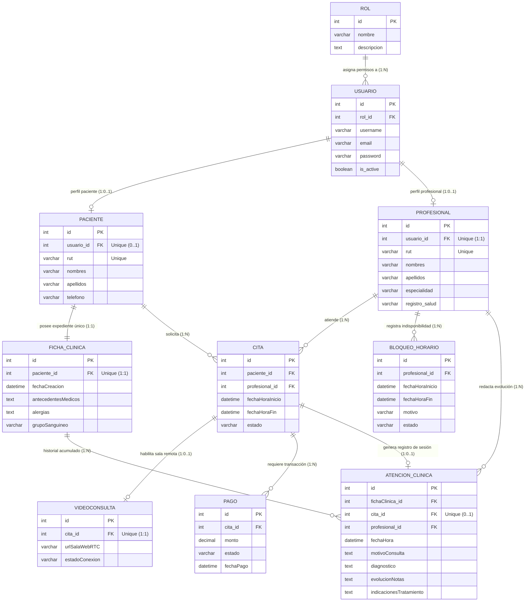

# 📊 Diagrama Entidad-Relación Corregido (Centro Nodo)
**Documento Técnico de Diseño de Base de Datos**  
**Proyecto:** Sistema de Gestión Clínica y Telemedicina – Centro Nodo (Osorno, Chile)

---

## 1. Resumen de Correcciones Realizadas

El diseño original presentaba inconsistencias en la semántica relacional y en la arquitectura clínica. Se aplicaron las siguientes correcciones en el modelo de datos ([clinica/models.py](file:///x:/Datos%20Proyectos/centro%20nodo/clinica/models.py)):

### A. Corrección de la Relación `USUARIO` ↔ `PACIENTE` / `PROFESIONAL`
* **Error anterior:** En la notación Crow's Foot, la "pata de gallo" (`>-o`, Muchos) apuntaba erróneamente hacia `USUARIO`. Esto expresaba que *"un paciente tiene muchos usuarios"*.
* **Solución aplicada:** Se definió una relación **1 a 1 (`OneToOneField`)** o **1 a 0..1**.
  * Cada `Usuario` con rol Profesional se vincula a exactamente **un único** perfil en `PROFESIONAL`.
  * Cada `Usuario` con rol Paciente se vincula a exactamente **un único** perfil en `PACIENTE`.
  * Los pacientes registrados presencialmente pueden existir con `usuario_id = NULL` hasta que activen su portal web.

### B. Inclusión de la Tabla Intermedia `ATENCION_CLINICA` (o `EVOLUCION_CLINICA`)
* **Error anterior:** `FICHA_CLINICA` tenía una clave foránea directa `cita_id FK`. Esto provocaba que se creara una "ficha clínica" nueva por cada cita, lo cual contradice la normativa de salud (Ley 20.584), donde **un paciente posee una única Ficha Clínica maestra** para todo su historial.
* **Solución aplicada:** Se creó la entidad intermedia **`ATENCION_CLINICA`**:
  * **`FICHA_CLINICA`** (1 a 1 con `PACIENTE`): Es el expediente maestro permanente (antecedentes médicos, grupo sanguíneo, alergias, fecha de apertura).
  * **`CITA`**: Es el evento de agendamiento y reserva de horario en la clínica.
  * **`ATENCION_CLINICA`**: Es el registro del acto médico. Vincula la sesión (`cita_id`) con el expediente del paciente (`ficha_clinica_id`) y el profesional tratante (`profesional_id`), almacenando el motivo de consulta, diagnóstico, notas de evolución e indicaciones terapéuticas.

### C. Incorporación de `BLOQUEO_HORARIO`
* Entidad implementada para permitir a los profesionales bloquear tramos horarios de su agenda por capacitaciones, licencias o descansos (`fechaHoraInicio`, `fechaHoraFin`, `motivo`, `estado`).

### D. Eliminación de Claves Duplicadas y Corrección de PKs
* Se eliminaron las referencias duplicadas (`cita_id`) que aparecían en las cajas de `PAGO` y `VIDEOCONSULTA`.
* En `CITA`, `paciente_id` queda correctamente tipificado como `FK` (no como `PK`).
* La relación directa "posee" entre `PACIENTE` y `PROFESIONAL` se eliminó por redundancia, ya que su vínculo se formaliza a través de las citas y atenciones médicas.

---

## 2. Diagrama Entidad-Relación Actualizado (Notación Mermaid)

---

## 3. Diccionario de Datos de las Nuevas Entidades

### `FICHA_CLINICA` (Expediente Clínico del Paciente)
| Campo | Tipo | Nulable | Descripción |
| :--- | :--- | :--- | :--- |
| `id` | AutoField (PK) | No | Identificador correlativo de la ficha clínica. |
| `paciente_id` | OneToOneField (FK) | No | Paciente titular exclusivo del expediente. |
| `fechaCreacion` | DateTimeField | No | Fecha y hora en que se aperturó la ficha en la clínica. |
| `antecedentesMedicos` | TextField | Sí | Historial de enfermedades preexistentes, cirugías o tratamientos psiquiátricos. |
| `alergias` | TextField | Sí | Medicamentos o sustancias que provocan reacción adversa. |
| `grupoSanguineo` | CharField(10) | Sí | Grupo y factor Rh (ej. O+, A-). |

### `ATENCION_CLINICA` (Acto Médico / Evolución)
| Campo | Tipo | Nulable | Descripción |
| :--- | :--- | :--- | :--- |
| `id` | AutoField (PK) | No | Identificador único de la atención médica. |
| `fichaClinica_id` | ForeignKey | No | Expediente del paciente al que se añade este registro. |
| `cita_id` | OneToOneField (FK) | Sí | Cita agendada que dio origen a la atención (si aplica). |
| `profesional_id` | ForeignKey | No | Especialista (psicólogo/psiquiatra) que efectuó la consulta. |
| `fechaHora` | DateTimeField | No | Momento cronológico de la sesión clínica. |
| `motivoConsulta` | TextField | No | Razón manifiesta por la que asiste el paciente. |
| `diagnostico` | TextField | No | Diagnóstico clínico según CIE-10 / DSM-5. |
| `evolucionNotas` | TextField | Sí | Notas clínicas confidenciales y progreso del tratamiento. |
| `indicacionesTratamiento` | TextField | Sí | Prescripción farmacológica o pautas terapéuticas entregadas al paciente. |

